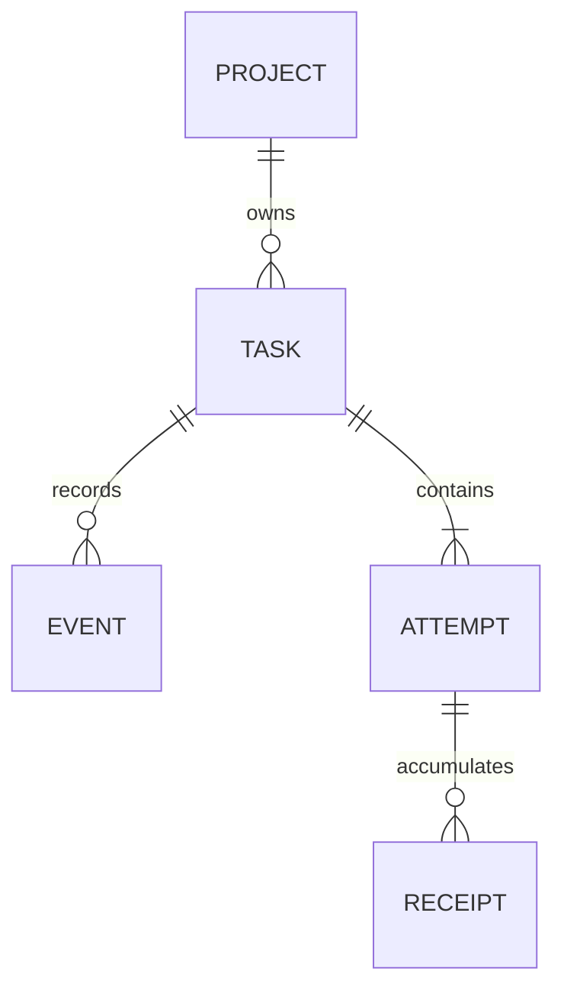

A project owns many tasks. A task has one attempt, or two when comparing candidates. Attempts and guarded turn receipts are embedded in the task document. The event history uses a separate SQLite table.

The host opens `it3-tasks.sqlite` under its state directory. The composite primary key of `tasks` is `(project, key)`. Events carry the same pair and the attempt number. An actor's request ID is unique per task, which makes retries idempotent. The event and the new task revision commit together. See `apps/server/src/it3/taskLedger.ts` for the schema and `packages/contracts/src/it3Tasks.ts` for the embedded document types.
